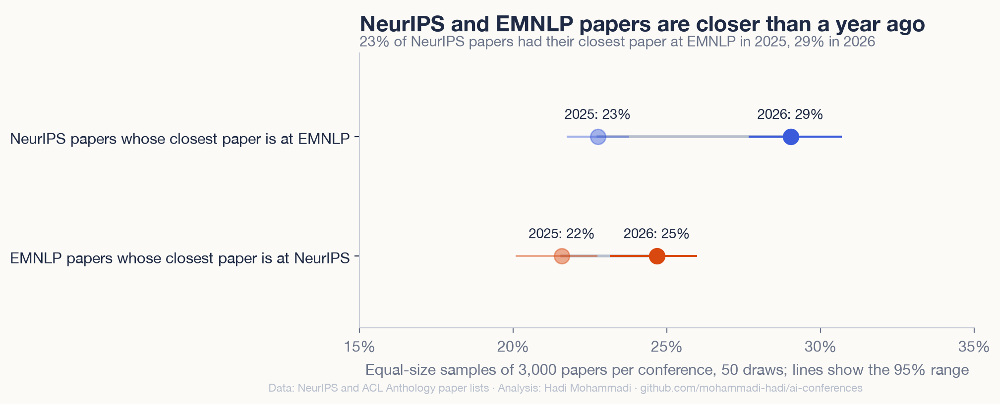
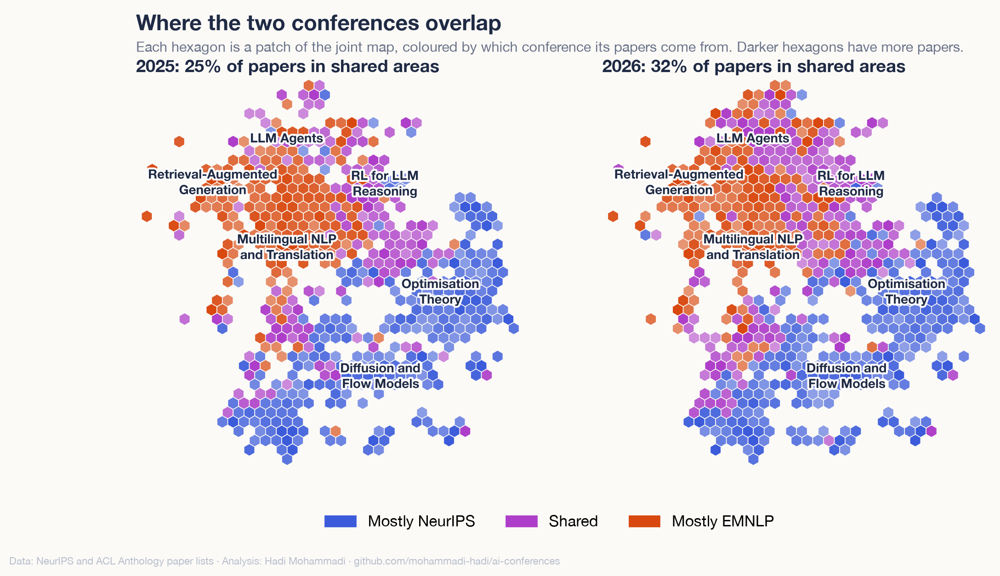
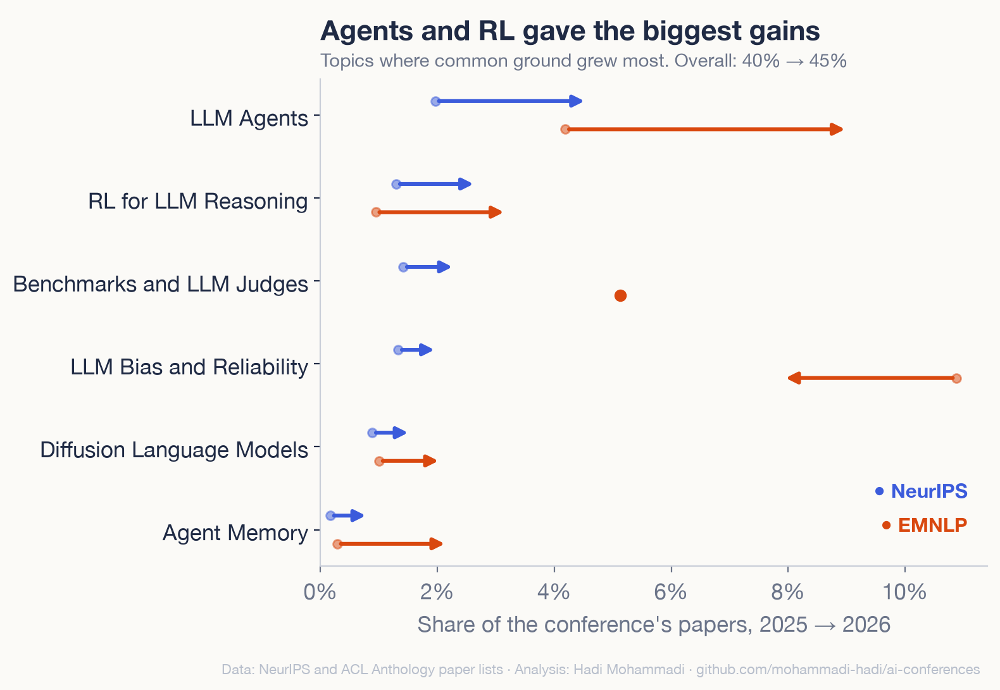
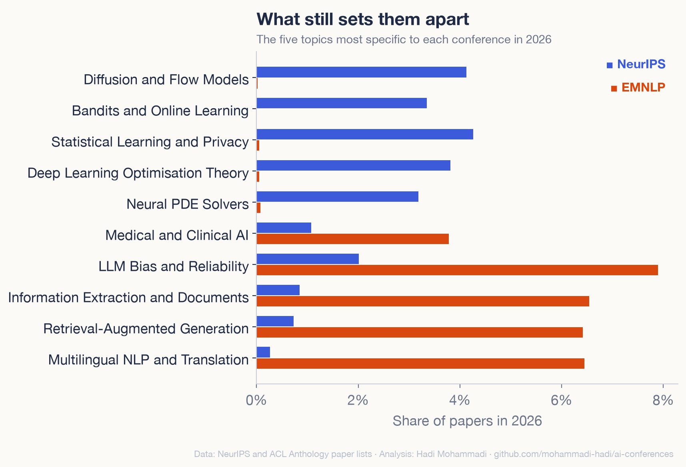

<!-- dek: NeurIPS and EMNLP papers of 2025 and 2026 on one map, and how much closer the two conferences got. -->
<!-- date: 29 October 2026 -->

# NeurIPS and EMNLP moved closer in 2026

NeurIPS is one of the largest machine learning conferences. EMNLP is one of the main conferences in natural language processing. I mapped both this year with the same model and the same method, so I could put all 23,984 papers from 2025 and 2026 on one map and ask a simple question. Are the two turning into one conference?

They moved closer. They are still far from the same.

<!-- atlas-hero -->
**[Open the map of both conferences →](https://mohammadi.cv/ai-conferences/2026/atlas.html)**

## Closer than a year ago

For each paper I looked up the paper most similar to it. In 2025, 23% of NeurIPS papers had their closest paper at EMNLP. In 2026 it was 29%. The other way round, EMNLP papers whose closest paper is at NeurIPS rose a little, from 22% to 25%.

NeurIPS is much bigger than EMNLP, and both grew, so these shares compare 3,000 papers from each conference, drawn at random 50 times. A simple classifier that guesses the conference from the vector of a paper's title and abstract also finds the task harder now. Its score (AUC, 20 draws) fell from 0.93 to 0.89.

## Where they overlap

I cut the joint map into small patches and coloured each one by which conference its papers come from, correcting for size. In 2025, 25% of all papers sat in patches that both conferences share about equally. In 2026 it was 32%, and still 31% when I shrink 2026 to the size of 2025. The shared ground grew most for agents, where half of the papers now sit in shared patches (up from 27%), and for evaluation and safety (16% to 34%).

## What brought them together

I sorted all the papers into 40 shared topics and measured the common ground: for each topic, the smaller of the two conferences' shares, added up. It went from 40% to 45%.

The biggest gains came from agents and from reinforcement learning for language models. They make up about half of all the topic gains, and nearly all of the net rise once shrinking topics such as chain-of-thought reasoning are subtracted. LLM agents went from 2.0% to 4.6% of NeurIPS papers and from 4.2% to 9.0% of EMNLP papers. RL for LLM reasoning went from 1.3% to 2.7% at NeurIPS and from 0.9% to 3.2% at EMNLP. Agent memory, close to nothing at either conference in 2025, now has 0.8% of NeurIPS and 2.2% of EMNLP.

Most of the gain is both conferences moving to the same new topics in the same year. NeurIPS also moved a little towards EMNLP's 2025 topics: its common ground with EMNLP 2025 went from 40% to 42%. EMNLP did not move towards NeurIPS 2025.

## What still sets them apart

Most of each conference is still its own. Diffusion and flow models, bandits, optimisation theory and neural PDE solvers are almost only at NeurIPS. Multilingual NLP and translation, retrieval-augmented generation and information extraction are mostly at EMNLP, though multilingual NLP and information extraction now make up a smaller share of EMNLP than last year.

The people did not converge much either. Matching author names, 25% of EMNLP authors also had a NeurIPS paper in 2025 and 28% in 2026. Both conferences grew by more than half (NeurIPS 56%, EMNLP 59%), which alone makes a shared name more likely. When I shrink 2026 to the size of 2025, the share of authors at both does not go up (24%).

## How I made it

The papers come from the public NeurIPS paper lists (main, datasets and evaluations, position and journal tracks) and from the ACL Anthology for EMNLP (main, Findings, industry and demo tracks). That is 5,856 and 9,110 NeurIPS papers and 3,484 and 5,534 EMNLP papers. An open model, Qwen3‑Embedding‑0.6B, turned each title and abstract into numbers, the same way in both atlases.

The 2026 papers are pre-release versions: EMNLP from the Anthology before its official release (read on 21 October) and NeurIPS from the conference's paper list, where many abstracts still have anonymised links.

The result held every way I checked it. With 30 or 60 topics instead of 40, or with only EMNLP's main track, the common ground rose by 5 to 6 points, and agent and RL topics made up 76% to 92% of the net rise. Abstracts also changed style between the two years at both conferences (far fewer "novel" and "enhance"), so I checked that this is not what brings them together. On titles alone, a classifier's score still falls (0.86 to 0.82). With the average 2025 to 2026 shift taken out of every vector, the closest-paper shares still rise (23% to 29% and 21% to 25%) and the common ground still grows (39% to 46%). Author names are matched loosely (first and last name), so that part is rough.

## Explore

[The joint map](https://mohammadi.cv/ai-conferences/2026/atlas.html) · [NeurIPS 2026 atlas](https://mohammadi.cv/neurips/2026/) · [EMNLP 2026 atlas](https://mohammadi.cv/emnlp/2026/) · [Code&nbsp;and&nbsp;data](https://github.com/mohammadi-hadi/ai-conferences)

Hadi Mohammadi · [mohammadi.cv](https://mohammadi.cv)
