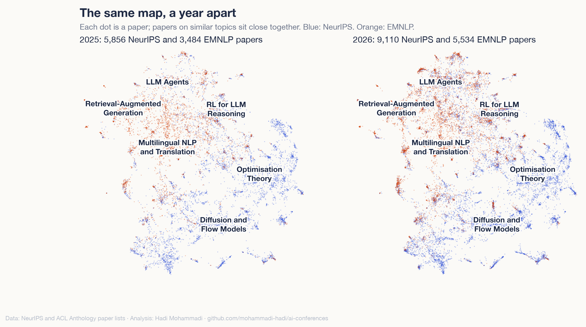

<!-- dek: NeurIPS and EMNLP papers of 2025 and 2026 on one map, and how much closer the two conferences got. -->
<!-- date: 29 October 2026 -->

# NeurIPS and EMNLP moved closer in 2026

NeurIPS is one of the largest machine learning conferences. EMNLP is one of the main conferences in natural language processing. I mapped both this year with the same model and the same method, so I could put all 23,984 papers from 2025 and 2026 on one map and ask a simple question. Are the two turning into one conference?

They moved closer. They are still far from the same.

<!-- atlas-hero -->
**[Open the map of both conferences →](https://mohammadi.cv/ai-conferences/2026/atlas.html)**

## Closer than a year ago

For each paper I looked up the paper most similar to it. In 2025, 23% of NeurIPS papers had their closest paper at EMNLP. In 2026 it was 29%. The other way round, EMNLP papers whose closest paper is at NeurIPS went from 22% to 25%.

NeurIPS is much bigger than EMNLP, and both grew, so every number here compares 3,000 papers from each conference, drawn at random 50 times. A simple classifier that guesses the conference from a paper's title and abstract also finds the task harder now. Its score (AUC) fell from 0.93 to 0.89.

## What brought them together

I sorted all the papers into 40 shared topics and measured the common ground: for each topic, the smaller of the two conferences' shares, added up. It went from 40% to 45%.

Most of that gain comes from agents and from reinforcement learning for language models. LLM agents went from 2.0% to 4.6% of NeurIPS papers and from 4.2% to 9.0% of EMNLP papers. RL for LLM reasoning went from 1.3% to 2.7% at NeurIPS and from 0.9% to 3.2% at EMNLP. Agent memory, close to nothing at either conference in 2025, now has 0.8% of NeurIPS and 2.2% of EMNLP.

Neither conference moved towards where the other one was. NeurIPS 2026 is not closer to EMNLP 2025 than NeurIPS 2025 was, and the same holds the other way. Both moved to the same new topics in the same year, and that is why they overlap more.

## What still sets them apart

Most of each conference is still its own. Diffusion and flow models, bandits, optimisation theory and neural PDE solvers are almost only at NeurIPS. Multilingual NLP and translation, retrieval-augmented generation and information extraction are almost only at EMNLP, though all three now make up a smaller share of EMNLP than last year.

The people did not converge much either. Matching author names, about a quarter of EMNLP authors also had a NeurIPS paper that year, in 2025 and in 2026. NeurIPS grew by 56%, which alone makes a shared name more likely. When I shrink 2026 to the size of 2025, the share does not go up.

## How I made it

The papers come from the public NeurIPS paper lists (main, datasets and evaluations, position and journal tracks) and from the ACL Anthology for EMNLP (main, Findings, industry and demo tracks). That is 5,856 and 9,110 NeurIPS papers and 3,484 and 5,534 EMNLP papers. An open model, Qwen3‑Embedding‑0.6B, turned each title and abstract into numbers, the same way in both atlases.

The result held every way I checked it. I tried 30 and 60 topics instead of 40, 10 and 50 neighbours instead of 20, and only the main track of EMNLP. The common ground rose by 5 to 6 points each time, and agent and RL topics made up 76% to 92% of the rise. Author names are matched loosely (first and last name), so that part is rough.

## Explore

[The joint map](https://mohammadi.cv/ai-conferences/2026/atlas.html) · [NeurIPS 2026 atlas](https://mohammadi.cv/neurips/2026/) · [EMNLP 2026 atlas](https://mohammadi.cv/emnlp/2026/) · [Code&nbsp;and&nbsp;data](https://github.com/mohammadi-hadi/ai-conferences)

Hadi Mohammadi · [mohammadi.cv](https://mohammadi.cv)
